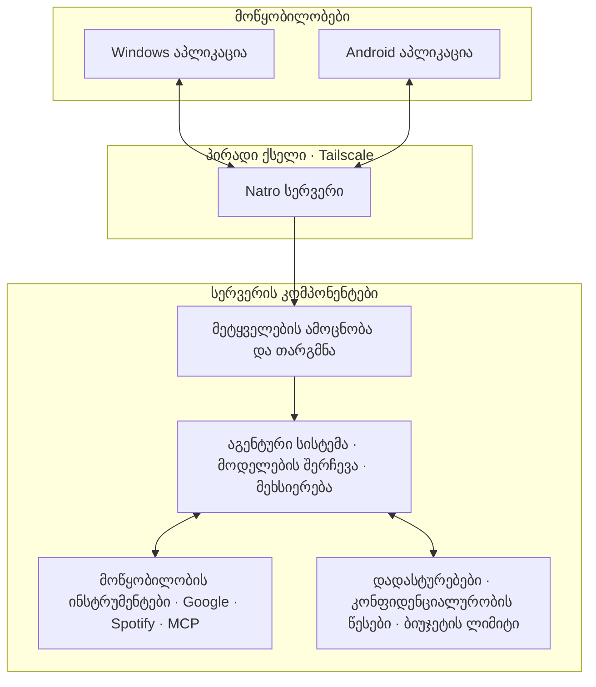

<div align="center">

# Natro

### შენი პერსონალური AI ასისტენტი — ყველა მოწყობილობაზე.

**ქართულ ენაზე ორიენტირებული ასისტენტი Windows-ისა და Android-ისთვის, რომელიც აკავშირებს აპლიკაციებს, ფაილებსა და ონლაინ სერვისებს — საკუთარი სერვერით, როგორც მთავარი სამუშაო გარემოთი.**

[](LICENSE)
[](https://www.microsoft.com/windows)
[](https://developer.android.com/)
[](https://www.python.org/)
[](https://kotlinlang.org/)
[](https://tauri.app/)

*რასაც ინატრებ, ნატრო შეგისრულებს.*

</div>

---

## მიმოხილვა

Natro არის პერსონალური AI ასისტენტი, რომელიც მუშაობს Windows-ის კომპიუტერსა და Android ტელეფონზე. მას ესმის ხმოვანი ბრძანებები — მათ შორის, ქართული მეტყველება ინგლისურ ტექნიკურ ტერმინებთან ერთად — და შეუძლია მოწყობილობების, ფაილებისა და დაკავშირებული სერვისების გამოყენებით დავალებების შესრულება.

ასისტენტის ძირითადი ნაწილი იმართება შენს მიერ კონტროლირებადი სერვერიდან. მოწყობილობები მას უკავშირდება პირადი [Tailscale](https://tailscale.com/) ქსელის მეშვეობით, ხოლო ლოკალური wake-word ამოცნობა აუდიოს მოწყობილობაზე ტოვებს მანამ, სანამ Natro-ს არ მიმართავ.

Natro-ს მთავარი პრინციპია: **ავტომატიზაცია უნდა იყოს სასარგებლო, გამჭვირვალე და შენს კონტროლქვეშ.** მნიშვნელოვანი შედეგების მქონე მოქმედებებს სჭირდება დადასტურება, ხოლო მარტივი ბრძანებები ზოგჯერ ენობრივი მოდელის გარეშეც სრულდება.

## ძირითადი შესაძლებლობები

- **ხმაზე ორიენტირებული მართვა** — გამოიძახე ასისტენტი ფრაზით „OK Natro“ ან კლავიატურის მალსახმობით.
- **მრავალმოწყობილობიანი მუშაობა** — გამოიყენე Natro Windows-ზე ან Android-ზე საერთო საუბრით.
- **კომპიუტერის მართვა** — გაუშვი აპლიკაციები, მოძებნე და შეამოწმე ფაილები, იმოქმედე ეკრანზე და გაუშვი დაშვებული სისტემური ბრძანებები.
- **Android-ის მართვა** — გახსენი აპლიკაციები, მართე მაღვიძარები და მედია, იმოქმედე ეკრანზე და გამოიყენე კონტაქტები, ზარები, შეტყობინებები და შეტყობინებების ცენტრი.
- **სერვისებთან ინტეგრაცია** — Google Calendar, Tasks, Gmail, Drive, Docs, Spotify, ვებ-ძიება და MCP ინსტრუმენტები.
- **ბრაუზერის ავტომატიზაცია** — გამოიყენე Microsoft Edge-ის საკუთარი სესია Playwright-ის მეშვეობით.
- **ფაილების გადაცემა** — გადაიტანე ფაილები კომპიუტერსა და ტელეფონს შორის სერვერის გამოყენებით, მათ შორის მაშინაც, როცა მოწყობილობა დროებით ხაზგარეშეა.
- **მეხსიერება და ჩანაწერები** — შეინახე სასარგებლო კონტექსტი და გრძელი ჩანაწერები Markdown ფაილების სახით.
- **შეხსენებები და ფონური დავალებები** — დაგეგმე შეხსენებები, მოითხოვე მოკლე ანგარიშები და გაუშვი ხანგრძლივი დავალებები ისე, რომ საუბრის გაგრძელება შეძლო.
- **პროაქტიული შეტყობინებები** — აკონტროლე შერჩეული მოვლენები, მაგალითად კონკრეტული კონტაქტისგან მიღებული შეტყობინებები ან მოახლოებული შეხვედრები.
- **ფაილების კონვერტაცია** — გადაიყვანე გავრცელებული დოკუმენტის, გამოსახულებისა და მედიის ფორმატები ისე, რომ ფაილი AI მოდელს არ გაეგზავნოს.
- **ხარჯების კონტროლი** — დააწესე API-ის ყოველთვიური ბიუჯეტი და მოითხოვე დადასტურება ლიმიტის გადაჭარბებამდე.

## როგორ მუშაობს



### ხმოვანი მოთხოვნიდან მოქმედებამდე

1. **ლოკალური გამოძახება.** კომპიუტერი იყენებს ლოკალურ Whisper მოდელს, ხოლო Android — მოწყობილობაზე მომუშავე საკვანძო ფრაზის ამოცნობას. აუდიო არ იგზავნება გამოძახებამდე.
2. **უსაფრთხო კავშირი.** მოწყობილობა მოთხოვნას WebSocket კავშირით აგზავნის სერვერზე, პირადი Tailscale ქსელის გავლით.
3. **ამოცნობა და თარგმნა.** Google Chirp 3 მეტყველებას ტექსტად გარდაქმნის, ხოლო Claude ქართულ ან შერეულენოვან მოთხოვნას აგენტისთვის გასაგებ ინგლისურ ფორმაში აყალიბებს.
4. **მოდელის შერჩევა.** Natro მარტივ მოთხოვნებს Claude Haiku-ს, ხოლო პერსონალურ ან რთულ დავალებებს Claude Sonnet-ს უგზავნის. თუ დავალება შეფერხდა, აგენტს შეუძლია უფრო ძლიერ მოდელზე გადართვა.
5. **ინსტრუმენტების გამოყენება.** აგენტი ირჩევს სერვერის ინტეგრაციებსა და დაკავშირებული მოწყობილობების ინსტრუმენტებს.
6. **პასუხი.** შედეგი ბრუნდება იმ მოწყობილობაზე, საიდანაც მოთხოვნა გაიგზავნა, და ეკრანზე ან ხმოვანი ფორმით გამოისახება.

მარტივ, წინასწარ განსაზღვრულ ბრძანებებს — მაგალითად, მუსიკის მართვას ან კომპიუტერის პარამეტრის შეცვლას — შეუძლიათ მოდელის გამოძახების გამოტოვება, რაც ამცირებს დაყოვნებასა და ხარჯს.

## კონფიდენციალურობა და კონტროლი

Natro შექმნილია ისე, რომ პერსონალური მონაცემები და მნიშვნელოვანი შედეგების მქონე მოქმედებები მკაფიო წესებით იყოს დაცული.

- **პირადი კავშირი:** მოწყობილობები სერვერს Tailscale-ის მეშვეობით უკავშირდება, ნაცვლად იმისა, რომ სერვისი პირდაპირ ინტერნეტში იყოს საჯაროდ ხელმისაწვდომი.
- **ლოკალური wake-word ამოცნობა:** აუდიო არ იგზავნება გამოძახებამდე.
- **მოდელების შერჩევა:** მოთხოვნები მხოლოდ Claude-ზე იგზავნება: ჩვეულებრივი — Claude Haiku-ზე, ხოლო პერსონალურ მონაცემებთან ან სარისკო მოქმედებებთან დაკავშირებული — მაგალითად, ელფოსტა, კალენდარი, ფაილები, მეხსიერება ან შეტყობინებები — Claude Sonnet-ზე.
- **მოქმედებების დადასტურება:** ისეთი მოქმედებები, როგორიცაა შეტყობინების გაგზავნა, წაშლა, დარეკვა, შეძენა ან აპლიკაციის იძულებით დახურვა, მოითხოვს დადასტურებას.
- **საბანკო და გადახდის საიტები:** ბრაუზერის წვდომა მხოლოდ წაკითხვით რეჟიმშია.
- **ხაზგარეშე მოწყობილობების დაცვა:** ხაზგარეშე მოწყობილობისთვის განკუთვნილი მოთხოვნა ელოდება მის ხელახლა დაკავშირებას და შესრულებამდე საჭიროებს დადასტურებას.
- **ბიუჯეტის ლიმიტი:** Natro-ს შეუძლია გაფრთხილება, როცა ხარჯი თვიური ლიმიტის 80%-ს მიაღწევს, და ლიმიტის გადაჭარბებამდე დადასტურება მოითხოვოს.
- **ლოკალური ფაილების კონვერტაცია:** კონვერტაცია ენობრივი მოდელისთვის ფაილის გაგზავნის გარეშე სრულდება.

ეს კონტროლები დამოკიდებულია კონფიგურაციასა და თითოეული ინტეგრაციისთვის მინიჭებულ უფლებებზე. Natro-ს მგრძნობიარე ანგარიშებთან გამოყენებამდე შეამოწმე პარამეტრები და დაკავშირებული სერვისები.

## პროექტის მდგომარეობა

Natro აქტიურად ვითარდება და ყოველდღიურ გამოყენებაშია. ძირითადი ასისტენტი, Windows და Android აპლიკაციები, მოწყობილობებს შორის კომუნიკაცია და მთავარი ინტეგრაციები მუშაობს; ახალი Tauri დესკტოპ ინტერფეისი ჯერ კიდევ მუშავდება.

| კომპონენტი | მდგომარეობა |
|---|---|
| სერვერის აგენტი, მეხსიერება, მოდელების შერჩევა და დადასტურებები | მუშაობს |
| Windows ხმოვანი ასისტენტი და კომპიუტერის ინსტრუმენტები (`desktop/helper/`) | მუშაობს |
| Android ასისტენტი და მოწყობილობის ინსტრუმენტები | მუშაობს |
| Google და Spotify ინტეგრაციები | მუშაობს |
| ფაილების გადაცემა, შეხსენებები და ფონური დავალებები | მუშაობს |
| ახალი Tauri დესკტოპ ინტერფეისი (`desktop/`) | მუშავდება |

ამჟამინდელი კომპიუტერის აპლიკაცია მხოლოდ Windows-ზე მუშაობს. Android აპლიკაცია განკუთვნილია Android 14+ და ARM64 მოწყობილობებისთვის და პირდაპირ ინსტალირდება — Play Store-ის გარეშე.

## დაწყება

Natro მოდულურია: დაიწყე ტექსტური ჩატით, შემდეგ დაამატე ხმოვანი მართვა, დაკავშირებული ანგარიშები, სერვერი და Android.

### მოთხოვნები

- Windows 10 ან 11 კომპიუტერი
- Python გარემოს სამართავად — [uv](https://docs.astral.sh/uv/)
- [Anthropic API გასაღები](https://console.anthropic.com/)
- სურვილისამებრ: Google Cloud-ის ავტორიზაციის მონაცემები, Spotify Developer მონაცემები და დამატებითი ინტეგრაციების API გასაღებები

### 1. რეპოზიტორიის ჩამოტვირთვა და კონფიგურაცია

```powershell
git clone https://github.com/natro-ge/natro.git
cd natro
powershell -ExecutionPolicy Bypass -File desktop\setup-pc.ps1 -SkipModels
```

`.env` ფაილში დაამატე Anthropic გასაღები:

```dotenv
ANTHROPIC_API_KEY=your_key_here
```

შემდეგ მოარგე ასისტენტი საკუთარ საჭიროებებს `server/identity/NATRO.md` ფაილში და `.env`-ში მიუთითე `NATRO_TIMEZONE`.

### 2. ტექსტური ჩატის გაშვება

რეპოზიტორიის ძირითადი საქაღალდიდან გაუშვი:

```powershell
.venv\Scripts\python.exe -m natro_agent.chat
```

ტექსტური ჩატი მოიცავს მეხსიერებასა და ჩანაწერებს. კომპიუტერზე მოქმედებების შესრულების გარეშე შესამოწმებლად გამოიყენე მხარდაჭერილი `--dry-run-pc` პარამეტრი.

### 3. Windows-ზე ხმოვანი მართვის ჩართვა

გაუშვი დაყენების სკრიპტი ხელახლა, ამჯერად `-SkipModels` პარამეტრის გარეშე, რათა ჩამოიტვირთოს ლოკალური ხმოვანი მოდელები (დაახლოებით 500 MB).

Google Cloud Speech-to-Text-ის კონფიგურაცია:

1. შექმენი პროექტი [Google Cloud Console](https://console.cloud.google.com/)-ში.
2. ჩართე **Cloud Speech-to-Text API**.
3. შექმენი service account **Cloud Speech Client** როლით.
4. მისი JSON გასაღები შეინახე რეპოზიტორიის ძირითად საქაღალდეში, სახელით `google-key.json`, და `.env`-ში დააკონფიგურირე `GOOGLE_CLOUD_PROJECT`.

გაუშვი სერვერი და Windows აპლიკაცია ცალკე ტერმინალებში:

```powershell
.venv\Scripts\python.exe -m natro_agent.server
```

```powershell
.venv\Scripts\python.exe -m natro_pc.app --wake
```

როცა wake-word მსმენელი მზად იქნება, თქვი „OK Natro“. `--wake` პარამეტრის გარეშე ჩაწერა Enter-ის დაჭერის შემდეგ იწყება; `--type` კი გაშვებულ სერვისთან ტექსტური მოთხოვნების გაგზავნის საშუალებას იძლევა.

ალტერნატიულად, გაუშვი tray აპლიკაცია:

```powershell
.venv\Scripts\pythonw.exe -m natro_pc.tray
```

### სურვილისამებრ ინტეგრაციები

| ინტეგრაცია | დაყენება |
|---|---|
| ვებ-ძიება | `.env`-ში დაამატე `TAVILY_API_KEY` |
| ამინდი | მიუთითე `NATRO_WEATHER_PLACE`; API გასაღები საჭირო არ არის |
| მარშრუტები და მგზავრობის დრო | დააკონფიგურირე `GOOGLE_MAPS_API_KEY`, `NATRO_HOME_ADDRESS` და `NATRO_TRAVEL_MODE` |
| Google Calendar, Tasks, Gmail, Drive, Docs | ჩართე შესაბამისი API-ები, დააკონფიგურირე OAuth და გაუშვი `natro_agent.google_signin` |
| Spotify | დააკონფიგურირე `SPOTIFY_CLIENT_ID` და გაუშვი `natro_agent.spotify_signin`; დაკვრის სამართავად საჭიროა Premium |
| დამატებითი ინსტრუმენტები | MCP სერვერები დააკონფიგურირე `server/config/mcp.json` ფაილში |

თითოეული ინტეგრაციის დეტალური ინსტრუქციები, Android-ის ინსტალაცია და სერვერის განთავსება აღწერილია ქვემოთ და პროექტის შესაბამის დოკუმენტაციაში.

### სერვერის განთავსება

იმისთვის, რომ Natro ხელმისაწვდომი იყოს მაშინაც, როცა კომპიუტერი გამორთულია, განათავსე აგენტი მუდმივად ჩართულ Linux სერვერზე. მიმდინარე კონფიგურაციისთვის საკმარისია მცირე სერვერი — დაახლოებით 2 vCPU და 4 GB RAM.

1. დააინსტალირე Tailscale სერვერზე, კომპიუტერსა და ტელეფონზე და გამოიყენე ერთი ანგარიში.
2. მიჰყევი [`server/deploy/README.md`](server/deploy/README.md) ინსტრუქციებს.
3. სერვერი ისე დააკონფიგურირე, რომ უსმენდეს Tailscale-ის მისამართზე და არა საჯარო ინტერფეისზე.
4. დააყენე ძლიერი `NATRO_DEVICE_TOKEN` და იგივე ტოკენი გამოიყენე დაკავშირებულ მოწყობილობებზე.

`.env`, API გასაღებები, OAuth ტოკენები და მოწყობილობის ტოკენები კონფიდენციალურად შეინახე. არასოდეს ატვირთო ისინი რეპოზიტორიაში.

### Android აპლიკაციის აწყობა

საჭიროა JDK 17+, Android SDK, platform 37 და build-tools 37.0.0.

შექმენი `android/local.properties` ფაილი და მიუთითე SDK-ის მისამართი და სერვერთან კავშირის მონაცემები:

```properties
sdk.dir=C\:\\Users\\you\\AppData\\Local\\Android\\Sdk
natro.server=ws://<server-tailscale-address>:8700
natro.token=<NATRO_DEVICE_TOKEN>
```

დაამატე სერვერის Tailscale მისამართი `android/app/src/main/res/xml/network_security_config.xml` ფაილში, შემდეგ ააწყვე და დააინსტალირე აპლიკაცია:

```powershell
android\gradlew.bat -p android assembleDebug
adb install -r android\app\build\outputs\apk\debug\app-debug.apk
```

პირველ გაშვებაზე მიანიჭე მხოლოდ ის უფლებები, რომლებიც შენთვის საჭირო ფუნქციებს სჭირდება. აპლიკაციის Settings ეკრანზე ხელმისაწვდომია ასისტენტის ფუნქციების კონფიგურაცია და ინსტრუქციები.

## რეპოზიტორიის სტრუქტურა

| საქაღალდე | დანიშნულება |
|---|---|
| `server/` | რაც სერვერზე მუშაობს: აგენტის ციკლი, მოდელების შერჩევა, იდენტობა, მეხსიერება, ინსტრუმენტები, მოწყობილობის სერვერი, ინტეგრაციები და ტესტები (`natro_agent/`, `tests/`); მეტყველების ამოცნობა და თარგმნა (`natro_voice/`); Linux სერვერის დაყენება და სერვისის გაშვება (`deploy/`) |
| `desktop/` | რაც Windows-ზე მუშაობს: ახალი Tauri 2 დესკტოპ ინტერფეისი (მუშავდება); მიმდინარე Windows აპლიკაცია, wake-word, კომპიუტერის ინსტრუმენტები, ხმოვანი პასუხი და tray აპლიკაცია (`helper/`); Windows-ის დაყენების სკრიპტი (`setup-pc.ps1`) |
| `android/` | Kotlin-სა და Jetpack Compose-ზე აგებული Android აპლიკაცია |
| `shared/` | სერვერსა და აპლიკაციებს შორის პროტოკოლი (`PROTOCOL.md`) და აპლიკაციის ხატულა (`branding/`) |
| `scripts/` | ხატულის დახატვის სკრიპტი |

მუშაობისას შექმნილი ფაილები — მაგალითად, `.env`, ავტორიზაციის მონაცემები, ტოკენები, მეხსიერება, ჩანაწერები, ლოგები და ჩამოტვირთული მოდელები — ლოკალურად იქმნება და Git-ში არ ხვდება: Windows-ზე `%LOCALAPPDATA%\Natro`-შია, სერვერზე კი რეპოზიტორიის ძირითად საქაღალდეში (Git-ში იგნორირებული); ორივე ადგილს `NATRO_HOME` ცვლის.

## განვითარება და ტესტები

დააყენე და დააკონფიგურირე პროექტი ზემოთ მოცემული ინსტრუქციების მიხედვით. რეპოზიტორიის golden tests რეალურ ინსტრუმენტულ ინტერფეისებს ამოწმებს ფასიანი API-ების გამოძახების გარეშე. ტესტები განსაკუთრებით ამოწმებს კონფიდენციალურობის წესებს, მოქმედებების დადასტურებასა და ხაზგარეშე მოწყობილობის ქცევას.

ხელმისაწვდომი ტესტების გასაშვებად გამოიყენე რეპოზიტორიის ძირითადი საქაღალდე:

```powershell
.venv\Scripts\python.exe -m pytest server
.venv\Scripts\python.exe -m pytest desktop\helper
android\gradlew.bat -p android testDebugUnitTest
cd desktop\src-tauri; cargo test
```

## მორგება

- **ასისტენტის იდენტობა:** შეცვალე `server/identity/NATRO.md`.
- **მეტყველების ლექსიკა:** სახელები და სასურველი მართლწერა დაამატე `server/natro_voice/wordlist.txt` ფაილში.
- **MCP ინსტრუმენტები:** სერვერები დააკონფიგურირე `server/config/mcp.json`-ში. თითოეული ჩანაწერით შეიძლება განისაზღვროს, შეიცავს თუ არა შედეგები პერსონალურ მონაცემებს და რომელ ინსტრუმენტებს სჭირდება დადასტურება.
- **ბიუჯეტი და გაშვების პარამეტრები:** შეცვალე `.env` ფაილი.

## ამჟამინდელი შეზღუდვები

- Windows აპლიკაცია მუშაობს Windows 10/11-ზე.
- Android აპლიკაცია განკუთვნილია Android 14+ ARM64 მოწყობილობებისთვის და პირდაპირ ინსტალირდება.
- ხმოვანი მოთხოვნები შეიძლება ქართულად, ინგლისური ტერმინების შერევით გაიგზავნოს; ხმოვანი პასუხები ამჟამად ინგლისურ ენაზეა.
- Spotify-ის დაკვრის მართვას სჭირდება Premium და ის ექვემდებარება Spotify-ის პერსონალური აპლიკაციის API შეზღუდვებს.
- Tauri დესკტოპ აპლიკაცია ჯერ კიდევ მუშავდება.

## ლიცენზია

Natro ვრცელდება [MIT ლიცენზიით](LICENSE).
