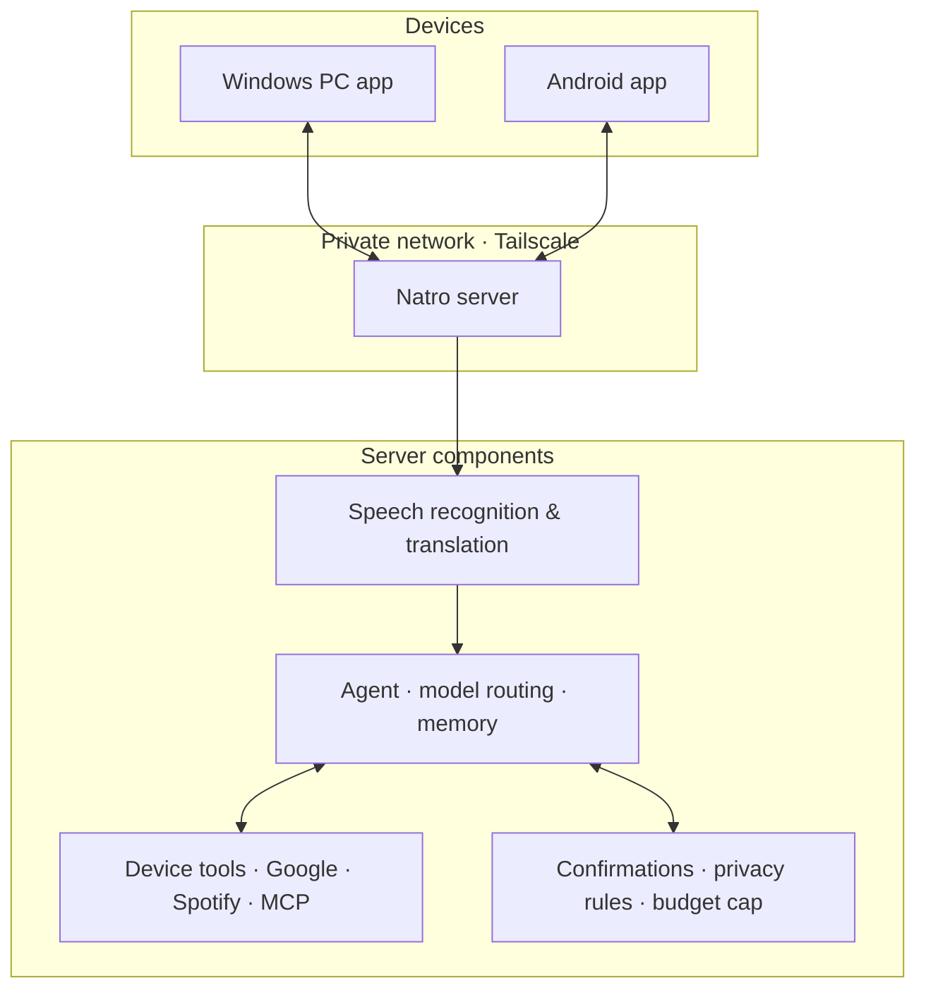

<div align="center">

# Natro

### Your personal AI assistant, across devices.

**A voice-first assistant for Windows and Android that connects your apps, files, and online services—with a private server as its brain.**

[](LICENSE)
[](https://www.microsoft.com/windows)
[](https://developer.android.com/)
[](https://www.python.org/)
[](https://kotlinlang.org/)
[](https://tauri.app/)

*Speak naturally. Get things done. Keep control.*

</div>

---

## Overview

Natro is a personal AI assistant that runs across your Windows PC and Android phone. It understands spoken requests—including Georgian speech mixed with English technical terms—and can use your devices, files, and connected services to carry out tasks.

The assistant's core runs on a server you control. Your devices connect to it over a private [Tailscale](https://tailscale.com/) network, while local wake-word detection keeps audio on-device until you ask for Natro.

Natro is built around a simple principle: **automation should be useful, observable, and under your control.** Actions with meaningful consequences require confirmation, and routine commands can bypass the language model entirely.

## Highlights

- **Voice-first interaction** — say “OK Natro” or use a keyboard shortcut to make a request.
- **Cross-device assistance** — use Natro from Windows or Android, with a shared conversation.
- **PC control** — launch applications, search and inspect files, interact with the screen, and run approved system commands.
- **Android control** — open apps, manage alarms and media, interact with the screen, and work with contacts, calls, messages, and notifications.
- **Connected services** — integrate Google Calendar, Tasks, Gmail, Drive, Docs, Spotify, web search, and MCP tools.
- **Browser automation** — use your own Microsoft Edge session through Playwright.
- **File transfer** — send files between the PC and phone through the server, including when a device is temporarily offline.
- **Memory and notes** — retain useful context and keep longer notes as Markdown files.
- **Reminders and background jobs** — schedule reminders, request briefings, and let longer tasks run while you continue chatting.
- **Proactive notifications** — monitor selected events, such as messages from a particular contact or upcoming meetings.
- **File conversion** — convert common document, image, and media formats without sending the file to an AI model.
- **Spending controls** — set a monthly API budget and require approval before exceeding it.

## How it works



### A request, from voice to action

1. **Wake locally.** The PC uses a local Whisper model; Android uses local keyword spotting. Audio is not sent before the wake phrase is detected.
2. **Send securely.** The device streams the request to the server over a WebSocket connection on your private Tailscale network.
3. **Recognize and translate.** Google Chirp 3 transcribes speech, and Claude converts Georgian or mixed-language input into clear English for the agent.
4. **Choose a model.** Natro routes routine requests to Claude Haiku and personal or complex requests to Claude Sonnet. The agent can escalate when a task gets stuck.
5. **Use tools.** The agent selects from server-side integrations and tools exposed by connected devices.
6. **Respond.** The answer returns to the requesting device and is shown or spoken aloud.

Common deterministic commands—such as controlling music or changing a PC setting—can skip the model call, reducing latency and cost.

## Privacy and control

Natro is designed to keep personal data and consequential actions behind explicit boundaries.

- **Private connectivity:** devices connect to the server over Tailscale rather than exposing the service directly to the public internet.
- **Local wake-word detection:** audio is not sent before the wake phrase is detected.
- **Model routing:** requests go to Claude only: routine ones to Claude Haiku, and those involving personal data or risky actions, such as email, calendar, files, memory, or notifications, to Claude Sonnet.
- **Action confirmation:** actions such as sending, deleting, calling, buying, or force-closing an application require approval.
- **Banking and payment sites:** browser access is read-only.
- **Offline-device safeguards:** requests for an offline device wait for that device to reconnect and require approval before execution.
- **Budget limit:** Natro can warn when spending reaches 80% of the configured monthly cap and ask before exceeding it.
- **Local file conversion:** conversion runs without sending the file to a language model.

These controls depend on your configuration and the permissions granted to each integration. Review the settings and connected services before using Natro with sensitive accounts.

## Project status

Natro is actively developed and used day to day. The core assistant, Windows app, Android app, device communication, and main integrations are working; the new Tauri desktop experience is still in progress.

| Component | Status |
|---|---|
| Server-side agent, memory, routing, and confirmations | Working |
| Windows voice assistant and PC tools (`pc/`) | Working |
| Android assistant and device tools | Working |
| Google and Spotify integrations | Working |
| File transfer, reminders, and background jobs | Working |
| New Tauri desktop interface (`desktop/`) | In progress |

The current PC application is Windows-only. The Android app targets Android 14+ on ARM64 devices and is installed directly rather than through the Play Store.

## Getting started

Natro is modular: start with text chat, then add voice, connected accounts, a server, and Android.

### Requirements

- Windows 10 or 11 PC
- [uv](https://docs.astral.sh/uv/) for Python environment management
- An [Anthropic API key](https://console.anthropic.com/)
- Optional: Google Cloud credentials, Spotify developer credentials, and API keys for additional integrations

### 1. Clone and configure

```powershell
git clone https://github.com/tuxa4life/Natro.git
cd Natro
powershell -ExecutionPolicy Bypass -File scripts\setup-pc.ps1 -SkipModels
```

Add your Anthropic key to `.env`:

```dotenv
ANTHROPIC_API_KEY=your_key_here
```

Then edit `agent/identity/NATRO.md` to personalize the assistant, and set `NATRO_TIMEZONE` in `.env`.

### 2. Run text chat

From the repository root:

```powershell
.venv\Scripts\python.exe -m natro_agent.chat
```

Text chat includes memory and notes. To test PC actions without executing them, use the supported `--dry-run-pc` option.

### 3. Enable voice on Windows

Run the setup script again without `-SkipModels` to download the local voice models (approximately 500 MB).

Configure Google Cloud Speech-to-Text:

1. Create a project in [Google Cloud Console](https://console.cloud.google.com/).
2. Enable the **Cloud Speech-to-Text API**.
3. Create a service account with the **Cloud Speech Client** role.
4. Save its JSON key as `google-key.json` in the repository root and configure `GOOGLE_CLOUD_PROJECT` in `.env`.

Start the server and PC app in separate terminals:

```powershell
.venv\Scripts\python.exe -m natro_agent.server
```

```powershell
.venv\Scripts\python.exe -m natro_pc.app --wake
```

Say “OK Natro” after the wake-word listener is ready. Without `--wake`, the app can record after you press Enter; `--type` enables typed requests to the running service.

Alternatively, start the tray application:

```powershell
.venv\Scripts\pythonw.exe -m natro_pc.tray
```

### Optional integrations

| Integration | Setup |
|---|---|
| Web search | Add `TAVILY_API_KEY` to `.env` |
| Weather | Set `NATRO_WEATHER_PLACE`; no API key required |
| Routes and travel times | Configure `GOOGLE_MAPS_API_KEY`, `NATRO_HOME_ADDRESS`, and `NATRO_TRAVEL_MODE` |
| Google Calendar, Tasks, Gmail, Drive, Docs | Enable the APIs, configure OAuth, and run `natro_agent.google_signin` |
| Spotify | Configure `SPOTIFY_CLIENT_ID` and run `natro_agent.spotify_signin`; Premium is required for playback control |
| Additional tools | Configure MCP servers in `agent/config/mcp.json` |

Integration-specific setup, Android installation, and server deployment are described in the sections below and in the linked project documentation.

### Deploy the server

To keep Natro available while your PC is off, deploy the agent to an always-on Linux server. A small instance (around 2 vCPU and 4 GB RAM) is sufficient for the current setup.

1. Install Tailscale on the server, PC, and phone, using the same account.
2. Follow [`deploy/README.md`](deploy/README.md).
3. Configure the server to listen on its Tailscale address, not a public interface.
4. Set a strong `NATRO_DEVICE_TOKEN` and use the same token on connected devices.

Keep `.env`, API keys, OAuth tokens, and device tokens private. Never commit them to the repository.

### Build the Android app

Requirements: JDK 17+, Android SDK, platform 37, and build-tools 37.0.0.

Create `android/local.properties` with your SDK path and server connection:

```properties
sdk.dir=C\:\\Users\\you\\AppData\\Local\\Android\\Sdk
natro.server=ws://<server-tailscale-address>:8700
natro.token=<NATRO_DEVICE_TOKEN>
```

Add the server's Tailscale address to `android/app/src/main/res/xml/network_security_config.xml`, then build and install:

```powershell
android\gradlew.bat -p android assembleDebug
adb install -r android\app\build\outputs\apk\debug\app-debug.apk
```

On first launch, grant only the permissions required for the features you intend to use. The app's Settings screen includes setup steps and controls for its assistant capabilities.

## Repository layout

| Path | Purpose |
|---|---|
| `agent/` | Agent loop, model routing, identity, memory, tools, device server, integrations, and tests |
| `voice/` | Speech recognition and translation |
| `pc/` | Current Windows app, wake word, PC tools, voice output, and tray app |
| `desktop/` | New Tauri 2 desktop interface (in progress) |
| `android/` | Android app built with Kotlin and Jetpack Compose |
| `deploy/` | Linux server setup and service deployment |
| `scripts/` | Windows setup scripts |

Runtime files such as `.env`, credentials, tokens, memory, notes, logs, and downloaded models are created locally and should remain untracked.

## Development and tests

Install and configure the project using the setup steps above. The repository's golden tests exercise the real tool interfaces without calling paid APIs. They focus on privacy routing, action confirmations, and behavior when a device is offline.

Run the available test suites from the repository root:

```powershell
.venv\Scripts\python.exe -m pytest agent
.venv\Scripts\python.exe -m pytest pc
android\gradlew.bat -p android testDebugUnitTest
cd desktop\src-tauri; cargo test
```

## Customization

- **Assistant identity:** edit `agent/identity/NATRO.md`.
- **Speech vocabulary:** add names and preferred spellings to `voice/wordlist.txt`.
- **MCP tools:** configure server entries in `agent/config/mcp.json`. Each entry can specify whether its results are personal and which tools require confirmation.
- **Budget and runtime settings:** configure them in `.env`.

## Current limitations

- The Windows application runs on Windows 10/11.
- The Android app targets Android 14+ on ARM64 and is distributed as a direct install.
- Spoken requests can be in Georgian with English terms mixed in; spoken replies are currently in English.
- Spotify playback control requires Premium and is subject to Spotify's personal-app API limitations.
- The Tauri desktop app is still under development.

## License

Natro is released under the [MIT License](LICENSE).
